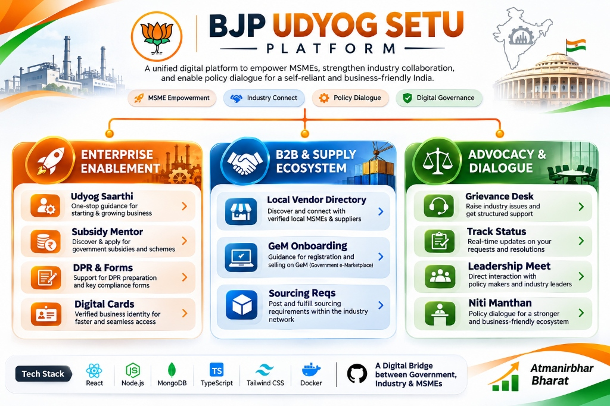
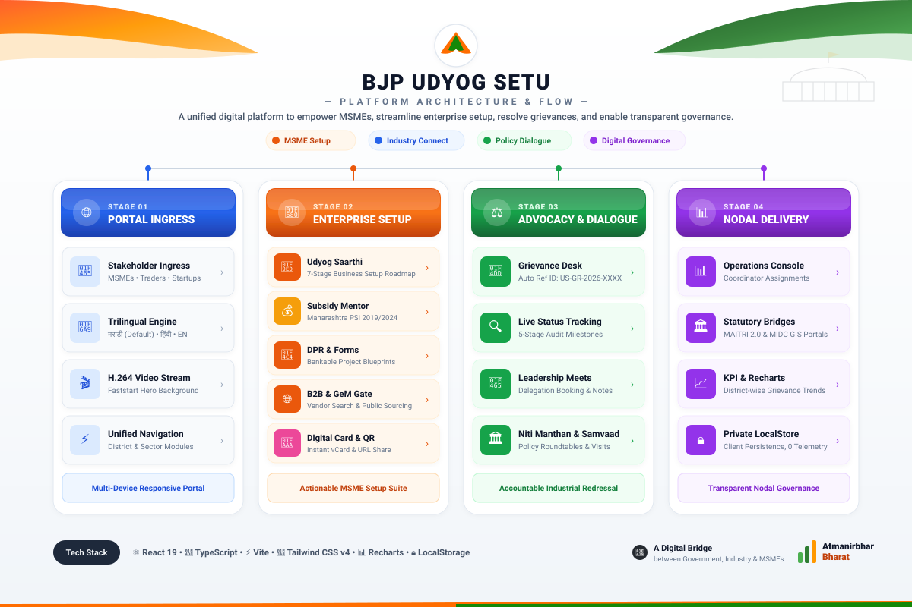
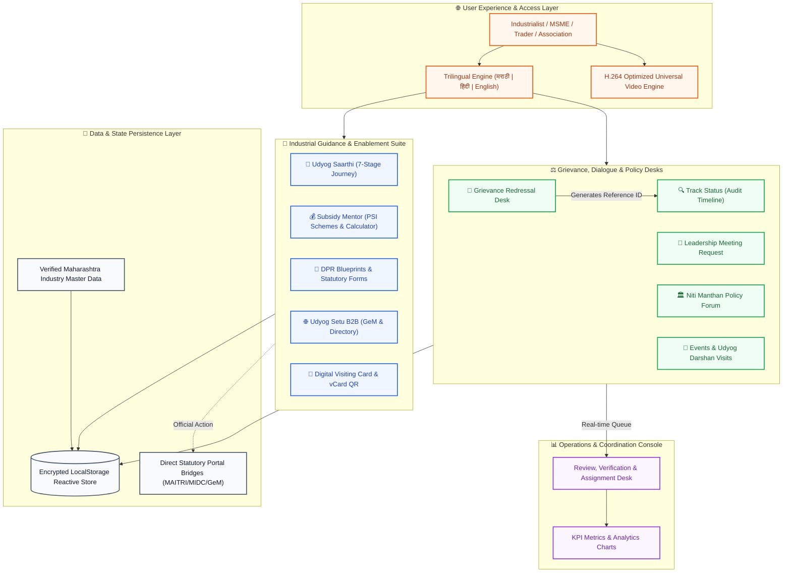

<div align="center">

  

  # 🇮🇳 भाजपा उद्योग सेतू • BJP UDYOG SETU
  ### महाराष्ट्र उद्योग माहिती, मार्गदर्शन आणि संवाद डिजिटल मंच
  **Maharashtra Industry Information, Guidance & Enterprise Dialogue Digital Platform**

  <p align="center">
    <em>Empowering Maharashtra's Industrialists, MSMEs, Startups & Trade Associations through a Unified, Guided & Trilingual Digital Ecosystem.</em>
  </p>

  <p align="center">
    <a href="#-key-features--modules"></a>
    <a href="#-trilingual-matrix"></a>
    <a href="#-technical-stack"></a>
    <a href="#-architecture--workflow"></a>
  </p>

  <p align="center">
    <a href="#-executive-overview">Executive Overview</a> •
    <a href="#-system-architecture--infographic">System Architecture</a> •
    <a href="#-key-features--modules">Core Modules</a> •
    <a href="#-trilingual-matrix">Trilingual Matrix</a> •
    <a href="#-official-portals-directory">Official Portals</a> •
    <a href="#-quick-start">Quick Start</a>
  </p>

  <hr style="margin: 24px 0; border: none; height: 1px; background: linear-gradient(to right, transparent, #E35914, #136938, transparent);" />
</div>

---

## 📌 Executive Overview

**BJP Udyog Setu (भाजपा उद्योग सेतू)** is a modern, responsive, and accessible digital platform engineered to bridge the communication gap between Maharashtra's enterprise ecosystem and administrative leadership. Designed with a **Marathi-first** philosophy and extended to full **Hindi** and **English** trilingual parity, the platform democratizes critical industrial knowledge, statutory compliance roadmaps, policy incentives, and grievance redressal mechanisms.

> [!NOTE]
> **Independent Information & Dialogue Demonstration**: This initiative operates as a citizen-centric guidance and delegation coordination platform. Statutory approvals, formal licensing, and statutory grievance submissions must be finalized through the respective linked official Government of Maharashtra portals (e.g. MAITRI 2.0, MIDC, Udyam, Aaple Sarkar).

---

## 🏛️ Strategic Pillars

<div align="center">
  
</div>

1. **Enterprise Enablement**: End-to-end guidance from conceptualization and land acquisition to statutory clearances and financial subsidies under the Maharashtra Package Scheme of Incentives (PSI).
2. **B2B & Supply Chain Ecosystem**: Connecting regional industrial clusters, supporting MSMEs in public procurement via GeM (Government e-Marketplace), and generating digital smart business cards.
3. **Transparent Redressal & Policy Dialogue**: Streamlining industrial grievance resolution tracking, facilitating direct delegation meetings with policy leadership, and conducting structured roundtables (*Niti Manthan*).

---

## 📊 System Architecture & Infographic

<div align="center">
  
</div>

<details>
<summary><b>🔍 View Raw Architecture Diagram & Flowchart Specification</b></summary>
<br>

The platform is engineered around a reactive, component-driven client architecture with seamless client-side state persistence, real-time query filtering, and dynamic multi-language localization:


</details>

---

## 🚀 Key Features & Modules

<details open>
<summary><b>1. 🧭 Udyog Saarthi (उद्योग सारथी) — Complete Enterprise Setup Workflow</b></summary>
<br>

A 7-stage interactive step-by-step roadmap walking entrepreneurs through the exact operational journey required to establish an industrial unit in Maharashtra:

```
[1. Idea & Feasibility] ──► [2. Entity Registration] ──► [3. Land Bank & MIDC]
                                                               │
[6. Utility Connections] ◄── [5. Construction & Approvals] ◄── [4. Clearances & NOCs]
          │
          └──► [7. Commercial Production & Market Access]
```

- **Interactive Checklists**: Detailed prerequisites for Proprietorship, LLP, Pvt Ltd, and Udyam certification.
- **MIDC Land Bank Integration**: Direct links to GIS mapping, e-bidding guidelines, and zoning categories.
- **Statutory Clearances Matrix**: Clear timelines for MPCB Consent to Establish (CTE), Fire NOC, Factory Inspectorate, and DISH guidelines.
</details>

<details>
<summary><b>2. 💰 Subsidy Mentor (सब्सिडी मेंटर) — Policy Benefits & Incentive Guidance</b></summary>
<br>

Demystifies Maharashtra’s progressive industrial policies, including the **Package Scheme of Incentives (PSI 2019 / 2024)**:

| Category | Policy Provision | Typical Eligible Support |
|---|---|---|
| **Capital Subsidy** | Investment Promotion Subsidy (IPS) | 30% to 100% of Fixed Capital Investment (FCI) based on taluka zoning (A/B/C/D/D+/Vidarbha & Marathwada) |
| **Power Tariff Subsidy** | Electricity Duty Exemption & Tariff Rebate | ₹1.00 to ₹2.00 per unit concession for 5 to 7 years in eligible zones |
| **Interest Subvention** | Term Loan Interest Subsidy | 5% per annum for eligible MSMEs |
| **Stamp Duty Waiver** | Property & Land Registration | 100% exemption on land purchase/lease within notified industrial areas |
| **Green Incentives** | Water Conservation, Energy Audit & Zero Liquid Discharge | Additional capital grants up to ₹50 Lakhs |
</details>

<details>
<summary><b>3. 📄 DPR Blueprints & Forms Desk (DPR व प्रपत्रे)</b></summary>
<br>

- **Bankable Project Reports**: Comprehensive templates for Manufacturing, Food Processing, Auto-Engineering, Textile, and Agro-clusters.
- **Financial Projections Engine**: Estimated capital expenditure (CAPEX), working capital (OPEX), Debt-Service Coverage Ratio (DSCR), and Internal Rate of Return (IRR) guidelines.
- **Direct Portal Jump**: One-click jump to MAITRI 2.0 and Central Government PMEGP / Mudra portals.
</details>

<details>
<summary><b>4. 🌐 Udyog Setu B2B Hub & GeM Procurement (उद्योग सेतू B2B)</b></summary>
<br>

- **Regional Vendor Discovery**: Searchable by industrial cluster, district, and specialization.
- **GeM Onboarding Stage-Gate**: 5-step checklist for MSE certification, vendor assessment, brand creation, and bid participation.
- **Sourcing Inquiry Board**: Post component requirements and receive local supplier matchings.
</details>

<details>
<summary><b>5. 🪪 Digital Business Card & Contact QR (डिजिटल उद्योग कार्ड)</b></summary>
<br>

- **Instant Generation**: Creates a high-impact, professional enterprise card with official industry badges.
- **vCard QR Code**: Real-time downloadable QR code that saves contact details directly to smartphone address books.
- **Zero-Storage Share URL**: All profile data is compressed into URL parameters for frictionless sharing via WhatsApp, email, or LinkedIn.
</details>

<details>
<summary><b>6. ⚖️ Grievance Redressal & Live Status Tracking (तक्रार निवारण व पाठपुरावा)</b></summary>
<br>

```
  [1. Submitted] 
        │
  [2. Under Review]
        │
  [3. Assigned to Nodal Officer] 
        │
  [4. Action in Progress] 
        │
  [5. Resolved & Acknowledged]
```

- **Unique Reference ID**: Auto-generated tracking ID (e.g. `US-GR-2026-XXXX`).
- **Interactive Timeline**: Timestamped visual progression milestones showing officer reviews, documentation requests, and resolution notes.
- **Citizen Communication Thread**: Submit follow-up clarifications directly against active tickets.
</details>

<details>
<summary><b>7. 👥 Leadership Delegations, Conclaves & Forums (उद्योग संवाद व नीती मंथन)</b></summary>
<br>

- **Leadership Meeting Requests**: Structured portal for industrial associations and business chambers to schedule formal delegation meetings with state leadership.
- **Udyog Samvaad**: Open dialogue and town hall registration across districts.
- **Niti Manthan**: Policy consultation platform gathering stakeholder recommendations on MSME growth, logistics, export policies, and labor reforms.
- **Udyog Darshan**: Organized industrial exposure and benchmark visits for youth and budding entrepreneurs.
</details>

<details>
<summary><b>8. 📊 Operations & Administrative Command Console (प्रशासकीय कक्ष)</b></summary>
<br>

- **Executive Analytics**: Real-time Recharts visualizations showing category-wise grievance distributions and district-wise registrations.
- **Status Operations Desk**: Administrative workflow to assign coordinators, record internal investigation notes, and mark resolutions.
- **Association Verifications**: Review and approve registered trade bodies and chambers of commerce.
</details>

---

## 🌐 Trilingual Matrix

BJP Udyog Setu provides **100% symmetrical linguistic fidelity**. There are no fallback compromises when selecting any of the three official languages:

| Feature / Area | 🚩 मराठी (Default) | 🇮🇳 हिंदी | 🌐 English |
|---|:---:|:---:|:---:|
| **Navigation & Branding** | ✅ पूर्ण (100%) | ✅ पूर्ण (100%) | ✅ Full (100%) |
| **Udyog Saarthi Stepper** | ✅ टप्पा १-७ (मराठी आकडे) | ✅ चरण १-७ (देवनागरी) | ✅ Stage 1-7 |
| **Subsidy Schemes & Cards** | ✅ संपूर्ण माहिती | ✅ संपूर्ण विवरण | ✅ Full Details |
| **B2B Directory & Filters** | ✅ स्थानिक शोध | ✅ स्थानीय खोज | ✅ Live Search |
| **Grievance Form & Alerts** | ✅ मराठी सूचना व पावती | ✅ हिंदी सूचना व रसीद | ✅ Full Validation |
| **Audit Status Badges** | ✅ तपासणी / निवारण | ✅ समीक्षा / निवारण | ✅ Under Review / Resolved |
| **Admin Control Desk** | ✅ प्रशासकीय नियंत्रण | ✅ प्रशासनिक नियंत्रण | ✅ Admin Console |

---

## 🔗 Official Portals Directory

The platform serves as an intelligent routing layer providing verified links to Maharashtra's statutory digital infrastructure:

| Department / Portal | Purpose | Official Direct URL |
|---|---|---|
| **MAITRI 2.0** | Maharashtra Single-Window Clearance System | [maitri.maharashtra.gov.in](https://maitri.maharashtra.gov.in/) |
| **MIDC Official Portal** | Industrial Plots, Infrastructure & Circulars | [midc.maharashtra.gov.in](https://midc.maharashtra.gov.in/en/) |
| **Udyam Registration** | National MSME Certificate & Classification | [udyamregistration.gov.in](https://udyamregistration.gov.in/) |
| **GeM Portal** | Government e-Marketplace Public Procurement | [gem.gov.in](https://gem.gov.in/) |
| **Aaple Sarkar** | Right to Public Services (RTS) Portal | [aaplesarkar.mahaonline.gov.in](https://aaplesarkar.mahaonline.gov.in/) |
| **MPCB Portal** | Consent to Establish & Operate Clearances | [mpcb.gov.in](https://www.mpcb.gov.in/) |
| **Labour Department** | Shop Act Registration & Factory Clearances | [labour.maharashtra.gov.in](https://labour.maharashtra.gov.in/) |
| **MahaTenders** | State Government E-Procurement Portal | [mahatenders.gov.in](https://mahatenders.gov.in/) |

---

## 🛠️ Technical Stack & Architecture

```
Front-End Core   : React 19.x + TypeScript 5.x + Vite 8.x
Styling System   : Tailwind CSS v4.x (Custom Devanagari Typography & Luminous Rails)
Animations       : Canvas Confetti + Particle Constellations + Micro-Transitions
Visual Graphics  : Lucide React + Recharts Dynamic Analytics
Data Engine      : Client-side Reactive LocalStorage Store with Deterministic Seeding
Video Delivery   : H.264 (AVC) Optimized Web Container with +faststart
Document Export  : PDF Receipt Generator & vCard Contact QR Engine
```

### 🔒 Privacy & Architecture Guarantees
- **Client-Side Isolated**: All demo applications, mock tickets, and digital cards persist securely in the user's browser sandbox via `localStorage`.
- **Zero Third-Party Trackers**: No external analytical scripts or tracking pixels are included.
- **Lightweight Assets**: Optimized H.264 hero video and lightweight vector typography guarantee sub-second initial render times.

---

## 🚀 Quick Start & Installation

### Prerequisites
- **Node.js**: v18.0.0 or higher
- **npm** or **pnpm** installed

### Setup Instructions

```bash
# 1. Clone the repository
git clone https://github.com/tejasshinde45/BJP-UDYOG-SETU-v0.2.git

# 2. Navigate to the project root
cd BJP-UDYOG-SETU-v0.2

# 3. Install dependencies
npm install

# 4. Start local development server
npm run dev

# 5. Build for production
npm run build
```

---

<div align="center">
  <p>
    <strong>BJP Udyog Setu (भाजपा उद्योग सेतू) • महाराष्ट्र</strong><br />
    <em>समृद्ध उद्योग, आत्मनिर्भर महाराष्ट्र • Empowering Enterprise, Fueling Growth</em>
  </p>
  <p>
    <sub>Crafted with dedication for Maharashtra's industrial community.</sub>
  </p>
</div>
